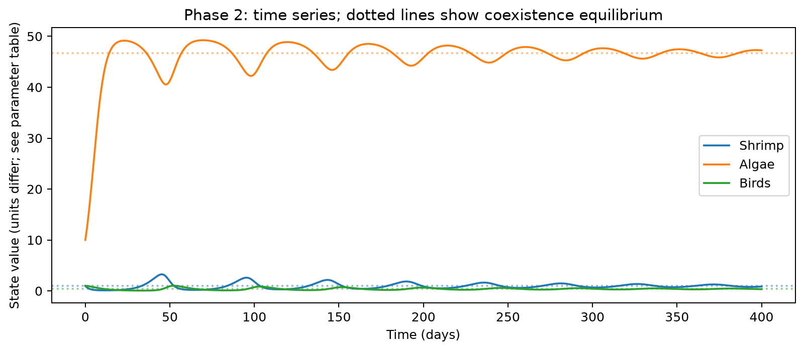
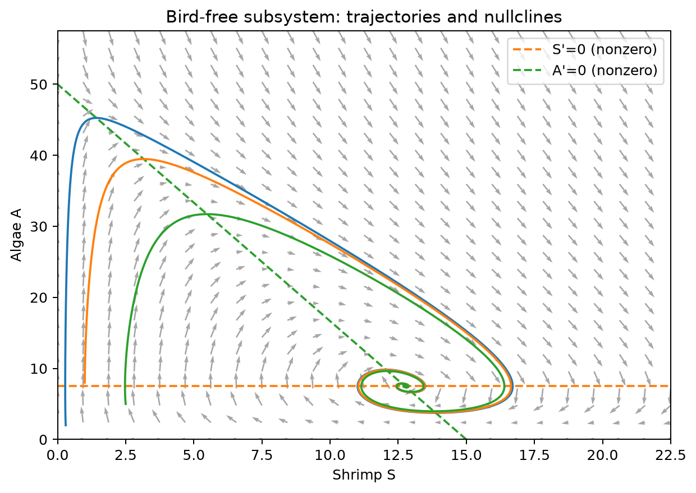

# Great Salt Lake Ecosystem Model 

## Units and parameter guesses

Time is in **days**; algae `A` is water chlorophyll-a in **µg Chl-a/L**; shrimp `S` is **individuals/L**; birds `B` is **individuals**. Chlorophyll represents the algae community, with *Dunaliella viridis* as the focal food species. All values below are provisional, not calibrated.

| Parameter | Meaning | Value | Units | Brief justification |
|---|---|---|---|---|
| `beta_A` | Algae growth rate | 0.3 | day⁻¹ | Full-blown guess |
| `K` | Algae carrying capacity | 50 | µg Chl-a/L | Full-blown guess |
| `C_A` | Shrimp clearance coefficient | 0.02 | L/(shrimp day) | Guess informed by clearance experiments (Makridis & Vadstein, 1999) |
| `C_S` | Effective bird feeding coefficient | 0.4 | 1/(bird day) | Full-blown guess |
| `gamma_S` | Shrimp gain per chlorophyll loss | 0.2 | shrimp/(µg Chl-a) | Full-blown guess |
| `gamma_B` | Bird gain per shrimp density loss | 0.3 | bird L/shrimp | Full-blown guess |
| `delta_S` | Shrimp natural mortality | 0.03 | day⁻¹ | Full-blown guess |
| `delta_B` | Bird natural mortality | 0.12 | day⁻¹ | Full-blown guess |
| `h_A` | Inverse maximum shrimp ingestion | 0.5 | day shrimp/(µg Chl-a) | Full-blown guess |
| `h_S` | Inverse maximum bird density removal | 0.5 | day bird L/shrimp | Full-blown guess |

Initial guesses: `S0 = 1` shrimp/L, `A0 = 10` µg Chl-a/L, `B0 = 1` bird. Salinity sources report experimental values in **ppt**; salinity is not yet included in the equations. Sources are listed at the bottom.

## Phase 1: Base model

Shrimp eat algae; birds eat shrimp. Feeding is proportional to food abundance, and algae grow without a resource limit.

$$
\begin{aligned}
\frac{dS}{dt} &= \gamma_S C_A S A - C_S S B,\\
\frac{dA}{dt} &= \beta_A A - C_A S A,\\
\frac{dB}{dt} &= \gamma_B C_S S B - \delta_B B.
\end{aligned}
$$

Each feeding term is a loss for the prey. Multiplying it by a conversion factor, `gamma_S` or `gamma_B`, gives the consumer's gain. These factors depend on the chosen units.

### Without birds

Shrimp have no death term, so they cannot decline. For positive initial algae and shrimp, grazing eventually drives algae toward zero while shrimp approach a constant density. This motivates adding natural shrimp mortality.

### Coexistence requires an exact balance

At a positive equilibrium, the algae and bird equations require the same shrimp density:

$$
S^*=\frac{\beta_A}{C_A}=\frac{\delta_B}{\gamma_B C_S}.
$$

Thus coexistence requires:

$$
\delta_B=\frac{\gamma_B C_S\beta_A}{C_A}.
$$

The original Phase 1 plots use `beta_A = 1`, `C_A = 0.5`, `C_S = 0.4`, and `gamma_B = 0.3`, giving a balance point of **0.24**. Those are the original illustrative values, not the updated guesses at the top.

This exact balance is fragile. Away from it, no strictly positive equilibrium exists. At the balance, the model has a family of coexistence equilibria rather than a single attracting equilibrium.

## Phase 2: Resource limits and shrimp mortality

Add logistic algae growth and natural shrimp mortality:

$$
\begin{aligned}
\frac{dS}{dt} &= \gamma_S C_A S A - C_S S B - \delta_S S,\\
\frac{dA}{dt} &= \beta_A A\left(1-\frac{A}{K}\right)-C_A S A,\\
\frac{dB}{dt} &= \gamma_B C_S S B - \delta_B B.
\end{aligned}
$$

- **`K`: algae carrying capacity.** Growth slows as algae approach `K`; grazing can keep algae below it.
- **`delta_S`: shrimp mortality.** Feeding must offset natural deaths before shrimp density can increase.

Positive coexistence can now occur across a range of bird mortality rates. When it exists, the positive equilibrium is locally stable.

### Time series

### Shrimp-algae phase plane without birds

### Bird mortality comparison

## Phase 3: Holling type II feeding

**Consumers can only eat so fast.** Holling type II makes feeding increase with food abundance, then approach a limit.

For one shrimp, Phase 2 uses unlimited proportional feeding; Phase 3 adds saturation:

$$
\text{Phase 2: } f_A(A)=C_A A,
\qquad
\text{Phase 3: } f_A(A)=\frac{C_A A}{1+h_A C_A A}.
$$

When food is scarce, the denominator is close to 1 and the models behave similarly. When food is abundant, processing and digesting it limit consumption.

| Quantity | Meaning |
|---|---|
| `C_A` | Initial slope: how quickly feeding increases at low algae concentration |
| `1/h_A` | Maximum consumption per shrimp per day |
| `1/(h_A C_A)` | Algae concentration where consumption reaches half its maximum |

Larger `h_A` means a lower feeding limit. Larger `C_A` increases feeding at low food without changing the maximum when `h_A` stays fixed.

### Example with our guesses

With `C_A = 0.02` and `h_A = 0.5`, maximum ingestion is **2 micrograms Chl-a/shrimp/day**, reached only as a limit. Half-saturation occurs at **100 micrograms Chl-a/L**.

| Algae (micrograms Chl-a/L) | Phase 2 ingestion | Phase 3 ingestion |
|---|---|---|
| 10 | 0.200 | 0.182 |
| 50 | 1.000 | 0.667 |
| 100 | 2.000 | 1.000 |
| 500 | 10.000 | 1.667 |

Ingestion is in micrograms Chl-a/shrimp/day. Concentrations above `K = 50` illustrate the feeding formula, not predicted lake conditions.

The limit applies to **each shrimp**. Multiply by shrimp density to get algae removal per liter: `S * f_A(A)`. At 10 micrograms Chl-a/L and 2 shrimp/L, Phase 3 removal is about **0.364 micrograms Chl-a/L/day**.

Bird feeding uses the same shape:

$$
f_S(S)=\frac{C_S S}{1+h_S C_S S}.
$$

Because birds are counts and shrimp is density, `f_S` measures shrimp-density removal per bird per day. Multiply by habitat volume in liters to obtain actual shrimp consumed per bird per day.

### Equations

$$
\begin{aligned}
\frac{dS}{dt} &= \gamma_S S f_A(A)-B f_S(S)-\delta_S S,\\
\frac{dA}{dt} &= \beta_A A\left(1-\frac{A}{K}\right)-S f_A(A),\\
\frac{dB}{dt} &= \gamma_B B f_S(S)-\delta_B B.
\end{aligned}
$$

Setting both handling parameters to zero recovers Phase 2. Saturation can change oscillations and stability; it does not guarantee stable coexistence.

### Feeding comparison

Algae, shrimp, and birds have different units, so their curve heights are not directly comparable. The [Phase 2](model2/phase2_model.ipynb) and [Phase 3](model3/phase3_model.ipynb) notebooks contain the simulations and equilibrium checks.

## Sources and calibration

### Algae, salinity, and shrimp observations

- [Utah DWR: Algae](https://wildlife.utah.gov/gslep/wildlife/algae). Identifies *Dunaliella viridis* as a preferred shrimp food. Our water-chlorophyll proxy includes other algae too.
- [Belovsky et al. (2025): Environment and phytoplankton relative abundances](https://link.springer.com/article/10.1007/s10452-025-10190-1). Chlorophyll measurements, *D. viridis* growth experiments, and South Arm monitoring from 1994-2020. Experimental salinities: **30, 60, 90, 120, and 150 ppt**. Its absolute growth measure is not directly our per-capita `beta_A`.
- [Utah DWQ: Great Salt Lake Data Explorer](https://udwq.shinyapps.io/GSL_data_explorer/). Chlorophyll and salinity observations, described in [DWQ's monitoring documentation](https://lf-public.deq.utah.gov/WebLink/ElectronicFile.aspx?dbid=0&docid=14163&eqdocs=DWQ-2021-018149&repo=Public). Check each record's units, location, depth, and date; the dashboard has not been inspected directly.
- [Utah DWR: Shrimp sampling reports](https://wildlife.utah.gov/gslep/harvest). Counts per liter by life stage and sex. Keep cysts separate from live shrimp and avoid double-counting female subcategories.

### Feeding experiments

- [Sura et al. (2017): Environmental impacts on grazing](https://link.springer.com/article/10.1007/s10750-016-3047-5). Great Salt Lake shrimp feeding on *D. viridis* and cyanobacteria under different conditions. Full text requires access; no numerical rate was extracted here.
- [Belovsky, Stumpf and Girgis (2024/2025): Artemia selective grazing](https://link.springer.com/article/10.1007/s10750-024-05719-8). Open-access experiments with algae alone and mixed. Ingestion is reported as biovolume/individual/hour, requiring conversion for our chlorophyll units.
- [Makridis and Vadstein (1999): Food size selectivity](https://academic.oup.com/plankt/article-abstract/21/11/2191/1499662). Maximum clearance rates convert to **0.0012-0.001512**, **0.006096**, and **0.03552-0.0504 L/(shrimp day)** at ages 2, 4, and 7 days. These laboratory rates inform the scale of our `C_A = 0.02` guess; they are not a measured lake-average or *D. viridis*-specific rate.

### Starting ranges

These are exploratory ranges, not confidence intervals.

| Parameter | Range to try | Basis |
|---|---|---|
| `C_A` | 0.002-0.05 L/(shrimp day) | Clearance-informed guess |
| `beta_A` | 0.1-0.6/day | Full-blown guess |
| `K` | 20-100 micrograms Chl-a/L | Full-blown guess |
| `delta_S` | 0.01-0.1/day | Full-blown guess |

For Phase 2, estimate `C_A` from clearance, or divide per-shrimp ingestion by food concentration. For Phase 3, fit the feeding curve at several concentrations to estimate both `C_A` and `h_A`.

Calibrate against observations from the same region and period. Bird coefficients still need a habitat volume: total consumption of `Q` shrimp/day in `V` liters removes density at `Q/V` shrimp/L/day. Chlorophyll-based conversion factors and handling parameters depend on our units. Changing water volume and bird migration are not represented explicitly.
