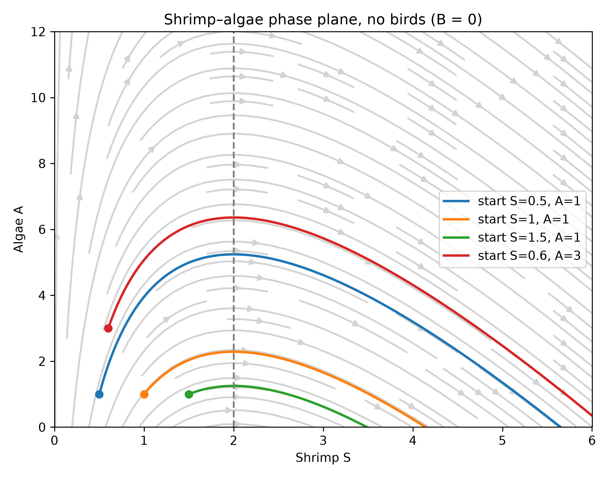
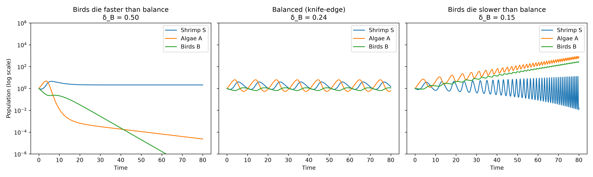
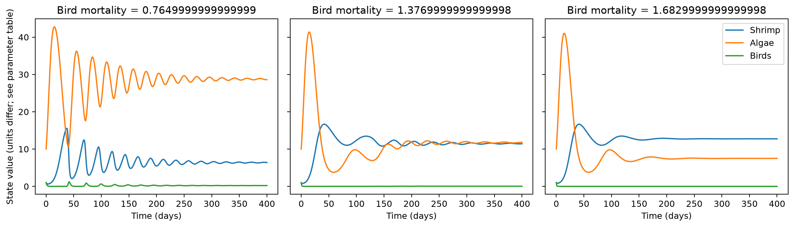
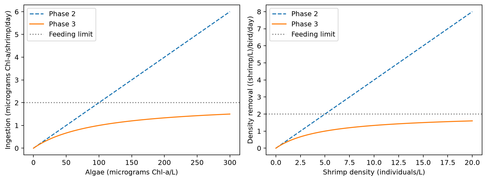
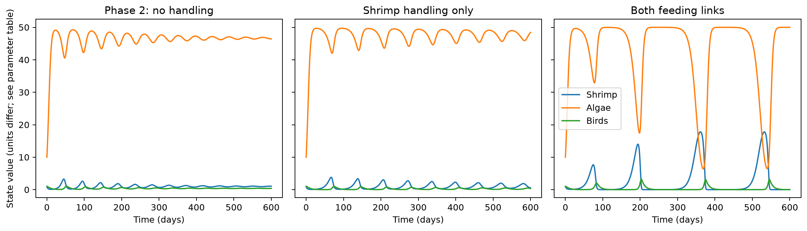

# Great Salt Lake Ecosystem Model 

## Units and parameter guesses

Time is in **days**; algae `A` is water chlorophyll-a in **µg Chl-a/L**; shrimp `S` is **individuals/L**; birds `B` is **individuals**. Chlorophyll represents the algae community, with *Dunaliella viridis* as the focal food species. All values below are provisional, not calibrated.

| Parameter | Meaning | Value | Units | Brief justification |
|---|---|---|---|---|
| `beta_A` | Algae growth rate | 0.3 | day⁻¹ | Full-blown guess |
| `K` | Algae carrying capacity | 50 | µg Chl-a/L | Full-blown guess |
| `C_A` | Shrimp clearance coefficient | 0.02 | L/(shrimp day) | Intermediate guess informed by laboratory clearance scales (Makridis & Vadstein, 1999) |
| `C_S` | Effective bird feeding coefficient | 0.4 | 1/(bird day) | Full-blown guess |
| `gamma_S` | Shrimp gain per chlorophyll loss | 0.2 | shrimp/(µg Chl-a) | Full-blown guess |
| `gamma_B` | Bird gain per shrimp density loss | 0.3 | bird L/shrimp | Full-blown guess |
| `delta_S` | Shrimp natural mortality | 0.03 | day⁻¹ | Full-blown guess |
| `delta_B` | Bird natural mortality | 0.12 | day⁻¹ | Full-blown guess |
| `h_A` | Inverse maximum shrimp ingestion | 0.5 | day shrimp/(µg Chl-a) | Full-blown guess |
| `h_S` | Inverse maximum bird density removal | 0.5 | day bird L/shrimp | Full-blown guess |

Initial guesses: `S0 = 1` shrimp/L, `A0 = 10` µg Chl-a/L, `B0 = 1` bird. Salinity sources report experimental values in **ppt**; salinity is not yet included in the equations. Full sources, study details, exploratory ranges, and conversion notes appear at the bottom.

## Base Model

### State Variables

| Symbol | Meaning |
|---|---|
| $S(t)$ | Brine shrimp density (individuals/L) |
| $A(t)$ | Water chlorophyll-a concentration (algae proxy) |
| $B(t)$ | Bird population |

### Equations

$$
\begin{aligned}
\frac{dS}{dt} &= \gamma_S C_A S A - C_S S B \\
\frac{dA}{dt} &= \beta_A A - C_A S A \\
\frac{dB}{dt} &= -\delta_B B + \gamma_B C_S S B
\end{aligned}
$$

### Parameters

| Symbol | Meaning |
|---|---|
| $\beta_A$ | Algae growth rate |
| $C_A$ | Interaction rate between shrimp and algae (shrimp eating algae) |
| $C_S$ | Interaction rate between birds and shrimp (birds eating shrimp) |
| $\gamma_S$ | Shrimp population gain per algae consumed |
| $\gamma_B$ | Bird population gain per shrimp consumed |
| $\delta_B$ | Natural death rate of birds |

### Interpretation of Terms

- **Interaction rates ($C$).** When two populations interact, one eats the other. For example, $C_S   S B$ is the rate at which birds eat shrimp, and $C_A   S A$ is the rate at which shrimp eat algae.
- **Conversion efficiencies ($\gamma$).** $\gamma$ is the population gain from one thing consuming another. For example, $\gamma_S C_A S A$ is the shrimp population gained from all the shrimp eating algae. These conversion factors have units determined by the population measurements; their numerical values are not universally bounded by one.
- **Natural death ($\delta$).** $\delta_B B$ is the loss of birds to natural death.

#### Term-by-term

| Equation | Term | Meaning |
|---|---|---|
| $S'$ | $+\gamma_S C_A S A$ | Shrimp growth from eating algae |
| $S'$ | $-C_S S B$ | Shrimp eaten by birds |
| $A'$ | $+\beta_A A$ | Algae growth |
| $A'$ | $-C_A S A$ | Algae eaten by shrimp |
| $B'$ | $-\delta_B B$ | Bird natural death |
| $B'$ | $+\gamma_B C_S S B$ | Bird growth from eating shrimp |

### Analysis
 

 
**Shrimp–algae plane (no birds).** With birds absent, shrimp have no loss term, so $S' = \gamma_S C_A S A \ge 0$ and the shrimp population can only grow. Algae rise while $S < \beta_A / C_A$ and fall once shrimp cross that nullcline. Every trajectory therefore drifts to the right and ends with algae grazed to zero and shrimp frozen at a constant level. There are no closed orbits and no equilibrium in which both survive.
 

 

<b>The Balance Point: Derivation</b>

> **Step 1: What we're looking for.** An *equilibrium* is a state where nothing changes, so all three derivatives are zero:
>
> $$
> S' = 0, \qquad A' = 0, \qquad B' = 0.
> $$
>
> We want a *coexistence* equilibrium, where shrimp, algae and birds are all present ($S, A, B > 0$).
>
> **Step 2: Factor each equation.** Each equation has its own population as a common factor, which makes it easy to read off when it equals zero.
>
> $$
> \begin{aligned}
> A' &= \beta_A A - C_A S A = A (\beta_A - C_A S)\\
> B' &= -\delta_B B + \gamma_B C_S S B = B (-\delta_B + \gamma_B C_S S)\\
> S' &= \gamma_S C_A S A - C_S S B = S (\gamma_S C_A A - C_S B)
> \end{aligned}
> $$
>
> A product is zero only if one of its factors is zero. Since we require $A, B, S > 0$, the expression in parentheses must be zero in each case.
>
> **Step 3: What algae need.** Setting algae's bracket to zero:
>
> $$
> \beta_A - C_A S = 0 \quad\Longrightarrow\quad S = \frac{\beta_A}{C_A}.
> $$
>
> Algae stay constant only when there are exactly enough shrimp for grazing to cancel algae growth. Fewer shrimp and algae grow; more shrimp and algae shrink.
>
> **Step 4: What birds need.** Setting birds' bracket to zero:
>
> $$
> -\delta_B + \gamma_B C_S S = 0 \quad\Longrightarrow\quad S = \frac{\delta_B}{\gamma_B C_S}.
> $$
>
> Birds stay constant only when there are exactly enough shrimp for bird births to cancel bird deaths.
>
> **Step 5: The conflict.** Algae and birds each demand a specific shrimp population, and they don't consult each other. Both conditions hold at once only if the two targets are equal:
>
> $$
> \frac{\beta_A}{C_A} = \frac{\delta_B}{\gamma_B C_S} \quad\Longrightarrow\quad \boxed{ \delta_B = \frac{\gamma_B C_S \beta_A}{C_A} }
> $$
>
> With our parameters ($\gamma_B = 0.3$, $C_S = 0.4$, $\beta_A = 1$, $C_A = 0.5$):
>
> $$
> \delta_B = \frac{0.3 \times 0.4 \times 1}{0.5} = 0.24.
> $$
>
> This is the **balance point**. For any other bird death rate, no coexistence equilibrium exists.

#### Behavior Away From the Balance Point
 
**Full model (time series).** Combining the algae and bird equations shows that
 
$$
\frac{d}{dt}\left[\gamma_B C_S \ln A + C_A \ln B\right] = \gamma_B C_S \beta_A - C_A \delta_B,
$$
 
a constant, so the outcome is fixed by its sign:
 
- **$\delta_B > 0.24$:** birds and algae decay exponentially toward extinction while shrimp level off.
- **$\delta_B = 0.24$:** neutral cycles; each initial condition traces its own closed orbit.
- **$\delta_B < 0.24$:** algae and birds grow without bound while shrimp oscillations widen.

**Conclusion.** The base model is structurally unstable: realistic, sustained coexistence occurs only on a single knife-edge parameter value, and any perturbation, such as a seasonal change or measurement error in $\delta_B$, sends the system to collapse or blow-up. The next version should add a carrying capacity for algae, $\beta_A A (1 - A/K)$, and a natural death term for shrimp, $-\delta_S S$, which together produce a stable coexistence equilibrium.

## Phase 2: Logistic Algae Growth and Natural Shrimp Mortality

The base model allows algae to grow without limit and shrimp to survive indefinitely when birds are absent. We now add a carrying capacity for algae and a natural death rate for shrimp.   

### Equations

$$
\frac{dS}{dt} = \gamma_S C_A S A - C_S S B - \delta_S S
$$

$$
\frac{dA}{dt} = \beta_A A\left(1 - \frac{A}{K}\right) - C_A S A
$$

$$
\frac{dB}{dt} = -\delta_B B + \gamma_B C_S S B
$$

### New Parameters

| Symbol | Meaning |
|---|---|
| $K$ | Algae carrying capacity in the absence of shrimp grazing |
| $\delta_S$ | Natural death rate of shrimp |

All other parameters keep their meanings from the base model.

### Interpretation of New Terms

- **Logistic algae growth.** $\beta_A A(1 - A/K)$ replaces unlimited exponential growth. When algae are scarce, they grow approximately as before. As algae approach $K$, their growth slows; above $K$, the growth term becomes negative.
- **Natural shrimp death.** $-\delta_S S$ accounts for shrimp dying even when birds are absent. Shrimp must now consume enough algae to offset these losses before their population can grow.

### Direction of Analysis

We will examine whether these changes allow stable coexistence across a range of parameter values. As in the base model, we will start with the shrimp/algae phase plane without birds, then examine time series for all three populations and vary the bird death rate.

Later, we may experiment with Holling type II feeding responses to represent consumption rates that saturate as food becomes abundant. For now, feeding interactions retain the base model's form.

### Example plots

## Phase 3: Holling Type II Feeding

We keep logistic algae growth and natural shrimp mortality from phase 2, and now allow feeding to saturate as food becomes abundant. Both shrimp eating algae and birds eating shrimp use a Holling type II response.

### Equations

$$
\frac{dS}{dt} = \gamma_S\frac{C_A S A}{1+h_A C_A A} - \frac{C_S S B}{1+h_S C_S S} - \delta_S S
$$

$$
\frac{dA}{dt} = \beta_A A\left(1-\frac{A}{K}\right) - \frac{C_A S A}{1+h_A C_A A}
$$

$$
\frac{dB}{dt} = -\delta_B B + \gamma_B\frac{C_S S B}{1+h_S C_S S}
$$

### Why feeding levels off

In Phase 2, each shrimp's feeding rate is proportional to the algae concentration:

$$
f_A(A)=C_A A.
$$

Twice as much algae means twice as much food consumed per shrimp per day. This rule has no upper limit: even an already well-fed shrimp would keep increasing its consumption as more algae appeared.

Holling type II adds a feeding limit. A shrimp needs time to collect, process, and digest food, so abundant food eventually stops increasing how fast it can eat:

$$
f_A(A)=\frac{C_A A}{1+h_A C_A A}.
$$

Here, `f_A` is chlorophyll-equivalent consumption per shrimp per day. Chlorophyll is our proxy for food, rather than a direct measurement of food mass.

| Parameter | What it changes |
|---|---|
| `C_A` | The initial slope of the feeding curve: how quickly consumption rises when algae is scarce |
| `h_A` | The inverse maximum feeding rate: larger values mean a lower feeding limit |

When algae is scarce, the denominator is close to 1, so Phase 3 behaves almost like Phase 2. When algae is abundant, the numerator and denominator both grow with algae concentration, and consumption approaches **1/h_A**. The curve bends toward this ceiling rather than increasing forever.

### A numerical example

With our guesses `C_A = 0.02 L/(shrimp day)` and `h_A = 0.5 day shrimp/(microgram Chl-a)`, the maximum ingestion rate is **2 micrograms Chl-a per shrimp per day**.

| Algae concentration (micrograms Chl-a/L) | Phase 2 ingestion (micrograms Chl-a/shrimp/day) | Phase 3 ingestion (same units) |
|---|---|---|
| 1 | 0.020 | 0.020 |
| 10 | 0.200 | 0.182 |
| 50 | 1.000 | 0.667 |
| 100 | 2.000 | 1.000 |
| 500 | 10.000 | 1.667 |

At 100 micrograms Chl-a/L, Phase 3 ingestion is half its maximum. This **half-saturation concentration** is:

$$
A_{\mathrm{half}}=\frac{1}{h_A C_A}.
$$

Below this concentration, feeding is more strongly limited by finding food. Above it, processing food increasingly limits consumption. Larger `C_A` increases feeding at low food and moves half-saturation to a lower concentration, without changing the maximum if `h_A` stays fixed. Larger `h_A` lowers the maximum and also moves half-saturation to a lower concentration.

The example above is calculated from our starting guesses. The handling times are full-blown guesses, not experimental estimates. Because our food unit is micrograms of chlorophyll, `h_A` is time per chlorophyll-equivalent food unit per consumer; it is not simply a number of days or a time per algal cell.

### From one shrimp to the ecosystem

The feeding limit applies to **each shrimp**, not to the entire population. Multiplying by shrimp density gives algae removal from each liter:

$$
\text{algae removal rate}=S f_A(A).
$$

For example, at 10 micrograms Chl-a/L, each shrimp consumes about 0.182 micrograms Chl-a/day under Phase 3. With 2 shrimp/L, total removal is about **0.364 micrograms Chl-a/L/day**. Doubling shrimp density doubles removal at the same food concentration, even though each shrimp has a feeding limit.

The algae equation subtracts this removal. The shrimp equation adds it multiplied by `gamma_S`, which converts food removal into shrimp production, and then subtracts predation and natural mortality.

### Birds use the same shape

Bird feeding saturates with shrimp density in the same way:

$$
f_S(S)=\frac{C_S S}{1+h_S C_S S}.
$$

With our mixed units, `f_S` is **shrimp-density removal per bird per day**. Actual shrimp eaten per bird per day requires multiplying by the modeled habitat volume in liters. Its ceiling is `1/h_S`; its half-saturation density is `1/(h_S C_S)`. Multiplying by bird count `B` gives the total shrimp-density loss in the equations. `h_S`, like `h_A`, is a full-blown guess.

Setting both handling parameters to zero removes the feeding limits and recovers Phase 2 exactly.

### Example trajectories and saved figures

Feeding saturation can change oscillations and equilibrium stability because abundant prey no longer cause unlimited per-consumer predation. It does not automatically stabilize the ecosystem. The [Phase 3 notebook](model3/phase3_model.ipynb) checks equilibrium stability and also plots the shrimp-algae subsystem without birds.

Both notebooks save PNG figures whenever their plotting cells run:

| Notebook | Saved figures |
|---|---|
| Phase 2 | `model2/figures/time_series.png`, `shrimp_algae_phase_plane.png`, `bird_mortality_comparison.png` |
| Phase 3 | `model3/figures/feeding_response.png`, `feeding_time_series.png`, `shrimp_algae_phase_plane.png` |

Paths are resolved from the project folder, so running from the project root or a notebook's folder saves to the same location. Rerunning replaces the corresponding figures; the Markdown examples then show those updated images.

## Sources and calibration notes

For this exploration, the algae state $A$ is **water-column chlorophyll-a concentration**, used directly as a proxy for algae abundance. Its units are **micrograms of chlorophyll-a per liter** (µg Chl-a/L). It is not total algal dry mass or carbon. Water chlorophyll includes multiple phytoplankton species; treating it as the food available to shrimp is a simplifying assumption.

*Dunaliella viridis* remains the focal algae species motivating the model. [Utah DWR, Algae and algal blooms](https://wildlife.utah.gov/gslep/wildlife/algae) identifies it as a preferred food of brine shrimp. The chlorophyll proxy is not a species-specific measurement of *D. viridis*.

### Sources for chlorophyll, salinity, and shrimp observations

- [Belovsky et al. (2025), Environment and phytoplankton relative abundances in a hypersaline lake: 27 years in Great Salt Lake, USA and experiments](https://link.springer.com/article/10.1007/s10452-025-10190-1): a source for chlorophyll-a measurements, salinity information, and experiments with *D. viridis*. Laboratory chlorophyll is measured in micrograms Chl-a/L. Experimental salinities are 30, 60, 90, 120, and 150 **ppt** (parts per thousand); these are experimental treatments, not a chosen present-day lake salinity. The study also analyzes South Arm field monitoring from 1994-2020. Its experimental absolute growth measure is not directly the per-capita `beta_A` in our equations.
- [Utah DWQ Great Salt Lake Data Explorer](https://udwq.shinyapps.io/GSL_data_explorer/): a place to look for lake chlorophyll-a and salinity observations. [DWQ monitoring documentation](https://lf-public.deq.utah.gov/WebLink/ElectronicFile.aspx?dbid=0&docid=14163&eqdocs=DWQ-2021-018149&repo=Public) describes these parameters. Check the downloaded record's units, date, location, depth, and method; the dashboard was not directly inspected. Do not interchange ppt and g/L without checking the reported salinity definition and brine density.
- [Utah DWR brine shrimp sampling reports](https://wildlife.utah.gov/gslep/harvest): observations **per liter of lake water**, separated by life stage and sex. Use the appropriate live-shrimp categories for $S$ and avoid double-counting female subcategories. Cysts are separate from live shrimp.

### Unit conversions and model assumptions

`gamma_S` and `gamma_B` are unit-dependent conversion factors, not necessarily dimensionless efficiencies or bounded by one. Chlorophyll-based conversions are effective model relationships rather than direct food-mass efficiencies.

Because birds are counts and shrimp is density, the bird predation terms still require a defined habitat volume when translating physical consumption into model coefficients. For a fixed volume $V$ in liters, total bird consumption $Q$ shrimp/day removes density at $Q/V$ shrimp/L/day. Thus `C_S`, `gamma_B`, and `h_S` include spatial conversions. Retaining the current equations is acceptable for exploration with effective coefficients, but a changing-volume model would require an explicit mass balance.

Next steps: select compatible lake observations, document their region, season, depths, and units, then estimate daily parameter ranges with sources and uncertainty. Salinity is recorded as context for now; the current equations do not yet depend on it.

### First guesses and feeding experiments

These are starting guesses for exploration, not fitted estimates or confidence intervals. Change one at a time before attempting a fit to observations.

| Parameter | First guess | Suggested exploratory range | Basis |
|---|---|---|---|
| `C_A` | 0.02 L/(shrimp day) | 0.002-0.05 | Order-of-magnitude guess informed by clearance experiments; not a measured *D. viridis* lake-average rate |
| `beta_A` | 0.3/day | 0.1-0.6/day | Full-blown guess |
| `K` | 50 micrograms Chl-a/L | 20-100 micrograms Chl-a/L | Full-blown guess |
| `delta_S` | 0.03/day | 0.01-0.1/day | Full-blown guess |

Other coefficients, including conversion factors, bird feeding/mortality, and Phase 3 handling times, retain the earlier illustrative values. They have no experimental calibration. Initial conditions are also guesses: 1 shrimp/L, 10 micrograms Chl-a/L, and 1 bird in an unspecified habitat. Bird-related results cannot be interpreted quantitatively until habitat volume and bird parameters are specified. No values were selected to guarantee coexistence.

**Experiments located:**

1. [Sura, Herlihy, Mahon and Belovsky (2017), Environmental impacts on grazing of different brine shrimp (Artemia franciscana) life stages](https://link.springer.com/article/10.1007/s10750-016-3047-5). Directly relevant: Great Salt Lake shrimp feeding on *D. viridis* and *Coccochloris elabens*, with life stage, salinity, temperature and food concentration varied. One-hour trials show that one universal feeding coefficient is a simplification. The publisher provides an abstract/preview; no numerical ingestion rate was extracted from its full text here. Best next source for condition-specific feeding estimates, potentially through university access.

2. [Belovsky, Stumpf and Girgis (published online 2024; volume 2025), Artemia selective grazing: survival value and nutritional intake](https://link.springer.com/article/10.1007/s10750-024-05719-8). Open-access experiments with *D. viridis*, cyanobacteria and diatoms, singly and mixed, across shrimp developmental stages. Reports ingestion as biovolume/individual/hour and describes chlorophyll, cell-count and biovolume conversions. Particularly useful for our community-chlorophyll approximation; rates must be converted before insertion into the equations.

3. [Makridis and Vadstein (1999), Food size selectivity of Artemia franciscana at three developmental stages](https://academic.oup.com/plankt/article-abstract/21/11/2191/1499662). The abstract reports maximum clearance rates of 50-63 microliters/individual/hour at 2 days old, 254 at 4 days, and 1.48-2.10 milliliters/individual/hour at 7 days. Converted by multiplying by 24 and converting to liters, these are 0.0012-0.001512, 0.006096, and 0.03552-0.0504 L/(individual day). These are laboratory maximum rates across tested particles, not a *D. viridis*-specific field estimate. They support exploring a broad feeding scale; `C_A=0.02` is our intermediate guess, not a reported experimental result.

For Phase 2, ingestion $I$ in micrograms Chl-a/(shrimp day) at food concentration $A$ gives $C_A=I/A$; clearance in L/(shrimp day) maps directly to `C_A` under the proportional-feeding assumption. For Phase 3, fit $I(A)=C_A A/(1+h_A C_A A)$ to multiple concentrations: `C_A` is the low-food slope and $1/h_A$ is the maximum ingestion rate. A single clearance measurement does not identify both parameters. For example, `C_A=0.02` predicts 0.2 micrograms Chl-a/(shrimp day) at $A=10$ in Phase 2; Phase 3's current guessed handling time reduces that to about 0.182.
